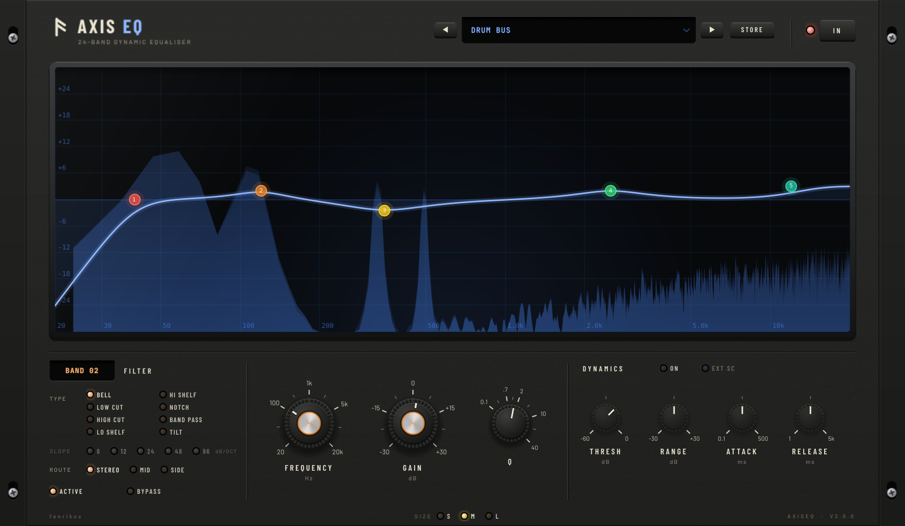

<div align="center">
  
  <h1>AxisEQ</h1>
  <p><b>A 24-band dynamic equaliser by fenrikos</b><br/>VST3 on Windows, macOS and Linux · AU on macOS · LV2 on Linux</p>
</div>

<div align="center">
  
</div>

## Features

- **24 bands, 8 filter types:** bell, low and high shelf, tilt, notch, band-pass, and low and high cuts
  from 6 to 96 dB/oct. Steep cuts are true Butterworth designs, -3 dB at the cutoff for every slope.
- **Dynamic EQ on every gain band.** Each band listens through a detector matched to it (band-pass for bells,
  low-pass for low shelves, high-pass for high shelves), so it only reacts to its own range. A negative range
  cuts when the band gets loud; a positive range boosts.
- **External sidechain per band,** e.g. duck the bass at 60 Hz only when the kick hits.
- **Stereo, Mid or Side** routing per band. In stereo routing the dynamics are linked, so the image stays put.
- **Click-free editing.** Moving a band is smoothed, and switching a band or changing its type, slope or
  routing crossfades.
- **Spectrum analyser** before and after, and an EQ curve drawn from the same filter design the audio uses.
- **Presets:** factory presets (also available as host programs) and your own user presets, safe with several
  instances open at once.
- **Zero latency,** with a click-free bypass that hosts also see as their bypass control.

## Using it

Click the canvas to add a band, drag a node to move it, right-click to bypass it, double-click to remove it.
Select a band to edit it in the strip below; turn on **Dynamic** to make it react to the signal.

## Building

AxisEQ uses CMake and JUCE 8. JUCE is fetched automatically unless you point the build at a local checkout.

```sh
cmake -B build -DCMAKE_BUILD_TYPE=Release            # optional: -DJUCE_DIR=/path/to/JUCE
cmake --build build --config Release --parallel
```

The plugins end up in `build/AxisEQ_artefacts/Release/`. Useful options:

| Option | Default | |
|---|---|---|
| `AXISEQ_TESTS` | ON | Builds `AxisEQTests`: filter accuracy, click-free switching, dynamics and preset safety |
| `AXISEQ_LTO` | ON | Link-time optimisation; turn off for faster development builds |
| `AXISEQ_SNAPSHOT` | OFF | Builds `AxisEQ_snapshot`, which renders the editor to PNG |

## Licence

Copyright (C) 2026 fenrikos.

AxisEQ is free software: you can redistribute it and/or modify it under the terms of the
[GNU Affero General Public License](LICENSE) as published by the Free Software Foundation, either version 3
of the License, or (at your option) any later version. It is distributed in the hope that it will be useful,
but WITHOUT ANY WARRANTY; without even the implied warranty of MERCHANTABILITY or FITNESS FOR A PARTICULAR
PURPOSE.

AxisEQ uses [JUCE](https://juce.com) under the AGPLv3, the VST 3 SDK (MIT) and LV2 (ISC).
